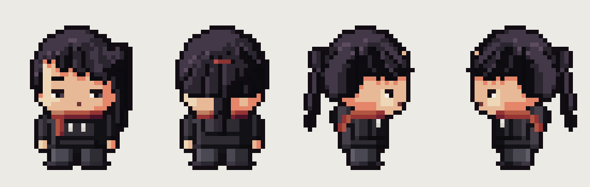
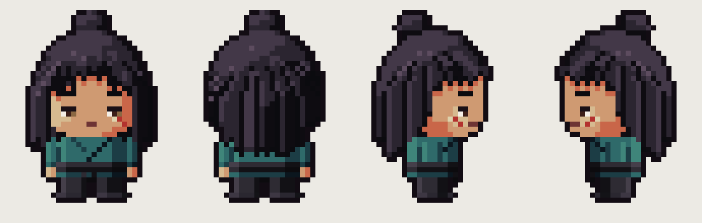
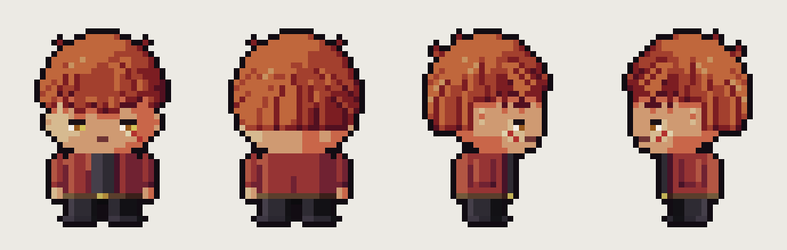
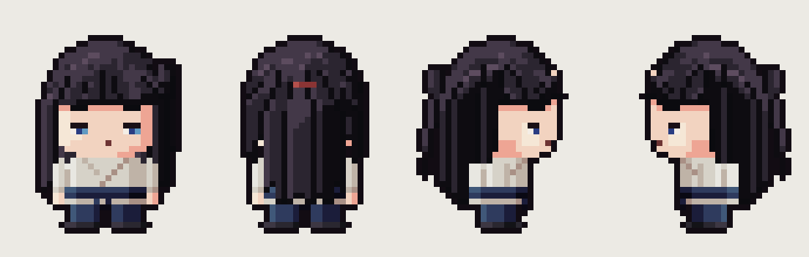
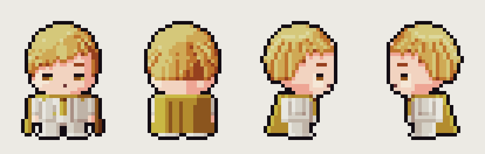
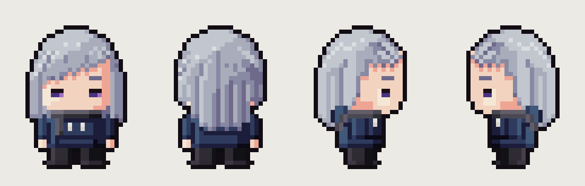

# 이야기 캐릭터 일러스트 프롬프트

> 자동으로 만든 파일입니다 (`node design/characters/make.js`). 손으로 고치지 마세요 — 바꾸려면 `make.js` 의 `CHARACTERS` 를 고치고 다시 뽑습니다.

이야기에서 꼭 만나는 사람(이야기 동료 둘 · 4대 길드 에이스 넷)을 제미나이 · GPT 로 **웹툰 · 애니메이션 느낌의 일러스트**로 뽑기 위한 프롬프트입니다.
게임 안의 픽셀 캐릭터(`js/allylook.js` 의 조합 그림)와 **머리 모양 · 옷 · 머리색 · 피부색 · 눈 색이 같아야** 하므로,
색 코드는 픽셀이 쓰는 색 목록에서 그대로 뽑았고, 픽셀 참고 그림을 같이 올리게 했습니다.

## 쓰는 법

1. **캐릭터 하나마다 새 대화창.** 한 대화에서 여러 사람을 이어 뽑으면 얼굴이 섞입니다.
2. 그 캐릭터의 **픽셀 참고 그림**(`design/characters/<id>.png`)을 먼저 올리고, 회색 상자 「전신」을 통째로 붙여 넣습니다.
3. 나온 그림을 봅니다 — 글자가 없나 · 배경이 한 가지 자홍색인가 · 발끝까지 다 나왔나 · **색이 픽셀과 같은가**(머리 · 피부 · 옷 · 눈).
   색이 틀리면 「COLOR LOCK 의 색 코드를 정확히 지켜서 다시」라고 합니다. 픽셀처럼(도트로) 나오면 「픽셀 아트가 아니라 일러스트로」.
4. 마음에 들면 **같은 대화에서** 회색 상자 「상반신」을 보내 대화창용 얼굴을 뽑습니다 (같은 대화라야 얼굴이 이어집니다).
5. 「저장할 이름」대로 저장합니다. 게임에 넣을 때는 다른 그림처럼 먼저 줄입니다 (배경 걷어내기 · 크기 줄이기 — 넣을 때 정함).

## 프롬프트에 이미 들어 있는 규칙

- **배경은 한 가지 자홍색(#FF00FF)** — 장비 그림처럼 나중에 도구가 걷어내 투명하게 만듭니다. 그래서 자홍 · 진분홍은 캐릭터에 쓰지 말라고 적었습니다.
- **COLOR LOCK** — 머리 · 피부 · 눈 · 윗옷 · 아래옷 · 포인트 · 신발 색을 픽셀과 같은 색 코드로, 그늘 색까지. 다른 큰 색은 쓰지 않게.
- 글자 없음 · 한 사람만 · 발끝까지 · 살짝 3/4 앞모습 · 현대 한국에 게이트가 열린 어반 판타지.
- 성격 · 표정 · 자세는 게임 대사에서 읽히는 대로. 사연(세계관 문서)은 넣지 않았습니다.

## 차례

| 캐릭터 | 역할 | 픽셀 참고 | 저장할 이름 (전신 · 상반신) |
|---|---|---|---|
| 하윤 | 첫 이야기 동료 · D급 · 추가타 | `design/characters/hayun.png` | `design/images/portraits/hayun-full.png` · `hayun-bust.png` |
| 단우 | 둘째 이야기 동료 · A급 · 버티기 | `design/characters/danwoo.png` | `design/images/portraits/danwoo-full.png` · `danwoo-bust.png` |
| 홍염 에이스 | 4대 길드 1위 홍염의 S급 · 시험관 · 광장 위기 게이트 | `design/characters/hongyeom.png` | `design/images/portraits/hongyeom-full.png` · `hongyeom-bust.png` |
| 청해 에이스 | 4대 길드 2위 청해의 S급 · 시험관 · 광장 위기 게이트 | `design/characters/cheonghae.png` | `design/images/portraits/cheonghae-full.png` · `cheonghae-bust.png` |
| 크라운 에이스 | 4대 길드 3위 크라운의 S급 · 시험관 · 광장 위기 게이트 | `design/characters/crown.png` | `design/images/portraits/crown-full.png` · `crown-bust.png` |
| 달 에이스 | 4대 길드 4위 달의 S급 · 시험관 · 광장 위기 게이트 | `design/characters/dal.png` | `design/images/portraits/dal-full.png` · `dal-bust.png` |

> 성별 · 나이는 여섯 모두 정해진 적이 없어 **제안**입니다. 4대 길드 에이스 넷은 생김새(머리 · 옷 · 색)까지 제안 — 게임에는 아직 그림이 없습니다. 바꾸려면 `make.js` 의 그 사람 `look` 을 고치고 다시 뽑습니다.
> 정해지면 게임의 시험관 · 광장 위기 게이트에도 같은 픽셀로 넣습니다.

---

## 하윤 — 첫 이야기 동료 · D급 · 추가타

협회 로비에서 먼저 말을 거는 헌터. 눈치가 빠르고 말수가 적은 편 — 「옆에서 한 번씩 더 칠게요」. (성별 · 나이는 제안: 20대 초반 여성)



픽셀 참고: `design/characters/hayun.png` (앞 · 뒤 · 옆 · 반대 옆)

| 부위 | 픽셀 생김새 | 색 |
|---|---|---|
| 머리 | 옆으로 앞머리 · 귀 덮음 · 뒤 없음 · 포니테일 · 숱 적게 | 검정 `#2b2530` |
| 피부 | | 흰 `#e8b996` |
| 눈 | 날카로운 눈 | 검정 `#2e2630` |
| 윗옷 | 후드 | 검정 `#2e2b33` |
| 아래옷 | 바지 | 먹색 `#4a4852` |
| 포인트 | 목도리 · 속옷 · 띠 · 넥타이 | 빨강 `#963434` |
| 신발 | | 검정 `#2a2730` |

### 전신

저장할 이름: `design/images/portraits/hayun-full.png`

```text
Make ONE image, 1024x1536 portrait: a full-body character illustration for a game. One character only.

HARD RULES — breaking any of these makes the image unusable:
1. NO TEXT ANYWHERE. No name, no caption, no signature, no logo, no letters or numbers.
2. The WHOLE body from the top of the hair to the soles of the shoes is inside the image, centered, with empty space around it. Nothing cut off.
3. The whole background is one flat magenta (#FF00FF). No gradient, no floor, no ground shadow, no scenery, no effects behind the character.
   Do not use magenta or hot pink on the character.

STYLE: modern Korean webtoon / anime character art. Clean thin lineart, cel shading (two tones plus one highlight), soft light from the upper left.
Attractive, slightly stylized proportions (about 7 heads tall). Urban-fantasy hunter setting: present-day Korea where gates and monsters appeared.

REFERENCE: the attached pixel sprite (front, back, side, other side) is THIS SAME CHARACTER in the game.
Copy its hairstyle, outfit shapes and colors exactly, but draw it as a detailed illustration — NOT as pixel art.

COLOR LOCK — the colors MUST match the pixel sprite. Use these as the main colors, nothing else as a main color:
- Hair: #2b2530  (shadows #0e0c11)
- Skin: #e8b996  (shadows #e58569)
- Eyes (iris): #2e2630  (shadows #0d0b0e)
- Top (main outfit color): #2e2b33  (shadows #121115)
- Bottom: #4a4852  (shadows #2f2d34)
- ACCENT: #963434  (shadows #702232)
- Shoes: #2a2730  (shadows #131317)
Small details (buttons, buckles, metal) may be silver or gold.

CHARACTER: a young woman in her early twenties, a D-rank hunter; quick-eyed, quiet, a little guarded but kind.
HAIR: side-swept bangs (swept toward the right side of the face), side hair covering the ears, short at the back of the neck, gathered into a high ponytail at the back, neat and close to the head.
FACE: sharp, narrow eyes; calm, slightly guarded look with a faint smile at one corner of the mouth.
OUTFIT: a hoodie with the hood down and two white drawstrings, long trousers, a scarf around the neck (ACCENT color), shoes in the Shoes color. A short practical dagger in a black sheath on the belt.
POSE: standing relaxed with the weight on one leg, one hand tugging the end of the scarf, the other hand resting near the dagger at the hip. Facing the viewer at a slight 3/4 angle.
```

### 상반신 (같은 대화에서 이어서)

저장할 이름: `design/images/portraits/hayun-bust.png`

```text
Now draw the SAME character again — same face, hair, outfit and colors as the full-body image above.
ONE image, 1024x1024: a bust portrait (from the top of the head to the middle of the chest), facing the viewer at a slight 3/4 angle.
Expression: calm, slightly guarded look with a faint smile at one corner of the mouth.
Same rules: no text, one flat magenta (#FF00FF) background, nothing else in the image.
```

---

## 단우 — 둘째 이야기 동료 · A급 · 버티기

청해 길드를 떠난 무인. 무뚝뚝한 사람 — 「길은 내가 연다. 너는 끝만 보고 가라.」 (성별 · 나이는 제안: 20대 후반 남성)



픽셀 참고: `design/characters/danwoo.png` (앞 · 뒤 · 옆 · 반대 옆)

| 부위 | 픽셀 생김새 | 색 |
|---|---|---|
| 머리 | 가르마 앞머리 · 볼까지 · 뒤 어깨까지 · 올림머리 · 숱 많이 | 검정 `#2b2530` |
| 피부 | | 구릿빛 `#cf9a72` |
| 눈 | 날카로운 눈 · 흉터 | 갈색 `#6a4430` |
| 윗옷 | 도복 | 청록 `#2f6a6a` |
| 아래옷 | 바지 | 검정 `#2e2b33` |
| 포인트 | — · 속옷 · 띠 · 넥타이 | 검정 `#2e2b33` |
| 신발 | | 검정 `#2a2730` |

### 전신

저장할 이름: `design/images/portraits/danwoo-full.png`

```text
Make ONE image, 1024x1536 portrait: a full-body character illustration for a game. One character only.

HARD RULES — breaking any of these makes the image unusable:
1. NO TEXT ANYWHERE. No name, no caption, no signature, no logo, no letters or numbers.
2. The WHOLE body from the top of the hair to the soles of the shoes is inside the image, centered, with empty space around it. Nothing cut off.
3. The whole background is one flat magenta (#FF00FF). No gradient, no floor, no ground shadow, no scenery, no effects behind the character.
   Do not use magenta or hot pink on the character.

STYLE: modern Korean webtoon / anime character art. Clean thin lineart, cel shading (two tones plus one highlight), soft light from the upper left.
Attractive, slightly stylized proportions (about 7 heads tall). Urban-fantasy hunter setting: present-day Korea where gates and monsters appeared.

REFERENCE: the attached pixel sprite (front, back, side, other side) is THIS SAME CHARACTER in the game.
Copy its hairstyle, outfit shapes and colors exactly, but draw it as a detailed illustration — NOT as pixel art.

COLOR LOCK — the colors MUST match the pixel sprite. Use these as the main colors, nothing else as a main color:
- Hair: #2b2530  (shadows #0e0c11)
- Skin: #cf9a72  (shadows #c96649)
- Eyes (iris): #6a4430  (shadows #3d1f19)
- Top (main outfit color): #2f6a6a  (shadows #1c3d45)
- Bottom: #2e2b33  (shadows #121115)
- ACCENT: #2e2b33  (shadows #121115)
- Shoes: #2a2730  (shadows #131317)
Small details (buttons, buckles, metal) may be silver or gold.

CHARACTER: a man in his late twenties, an A-rank martial artist; stoic, steady, speaks little.
HAIR: center-parted bangs, side locks down to the cheeks, back hair reaching the shoulders, tied up in a top bun, thick and voluminous.
FACE: sharp, narrow eyes, a small diagonal scar on the left cheek; stern, steady eyes, mouth set in a straight line.
OUTFIT: a martial-arts uniform with a crossed collar, tied with a belt (the belt is the ACCENT color), long trousers, shoes in the Shoes color. The uniform is old and worn, mended in a few places.
POSE: standing straight, one fist resting in the other palm in front of the chest (a martial-arts salute). Facing the viewer at a slight 3/4 angle.
```

### 상반신 (같은 대화에서 이어서)

저장할 이름: `design/images/portraits/danwoo-bust.png`

```text
Now draw the SAME character again — same face, hair, outfit and colors as the full-body image above.
ONE image, 1024x1024: a bust portrait (from the top of the head to the middle of the chest), facing the viewer at a slight 3/4 angle.
Expression: stern, steady eyes, mouth set in a straight line.
Same rules: no text, one flat magenta (#FF00FF) background, nothing else in the image.
```

---

## 홍염 에이스 — 4대 길드 1위 홍염의 S급 · 시험관 · 광장 위기 게이트

「불 좀 붙여 봐. 미지근하면 바로 끝낸다.」 — 거칠고 뜨거운 싸움꾼. (생김새는 제안: 남성 · 붉은 뻗친 머리 · 빨간 재킷)

길드: 홍염 — 붉은 불꽃 문장, 뜨겁고 거친 쪽



픽셀 참고: `design/characters/hongyeom.png` (앞 · 뒤 · 옆 · 반대 옆)

| 부위 | 픽셀 생김새 | 색 |
|---|---|---|
| 머리 | 삐죽 앞머리 · 귀 보임 · 뒤 없음 · 뻗친 정수리 · 숱 많이 | 빨강 `#a3402e` |
| 피부 | | 구릿빛 `#cf9a72` |
| 눈 | 날카로운 눈 · 흉터 | 금색 `#c99a2e` |
| 윗옷 | 재킷 | 빨강 `#963434` |
| 아래옷 | 바지 | 검정 `#2e2b33` |
| 포인트 | 허리띠 · 속옷 · 띠 · 넥타이 | 검정 `#2e2b33` |
| 신발 | | 검정 `#2a2730` |

### 전신

저장할 이름: `design/images/portraits/hongyeom-full.png`

```text
Make ONE image, 1024x1536 portrait: a full-body character illustration for a game. One character only.

HARD RULES — breaking any of these makes the image unusable:
1. NO TEXT ANYWHERE. No name, no caption, no signature, no logo, no letters or numbers.
2. The WHOLE body from the top of the hair to the soles of the shoes is inside the image, centered, with empty space around it. Nothing cut off.
3. The whole background is one flat magenta (#FF00FF). No gradient, no floor, no ground shadow, no scenery, no effects behind the character.
   Do not use magenta or hot pink on the character.

STYLE: modern Korean webtoon / anime character art. Clean thin lineart, cel shading (two tones plus one highlight), soft light from the upper left.
Attractive, slightly stylized proportions (about 7 heads tall). Urban-fantasy hunter setting: present-day Korea where gates and monsters appeared.

REFERENCE: the attached pixel sprite (front, back, side, other side) is THIS SAME CHARACTER in the game.
Copy its hairstyle, outfit shapes and colors exactly, but draw it as a detailed illustration — NOT as pixel art.

COLOR LOCK — the colors MUST match the pixel sprite. Use these as the main colors, nothing else as a main color:
- Hair: #a3402e  (shadows #7c1d22)
- Skin: #cf9a72  (shadows #c96649)
- Eyes (iris): #c99a2e  (shadows #98591c)
- Top (main outfit color): #963434  (shadows #702232)
- Bottom: #2e2b33  (shadows #121115)
- ACCENT: #2e2b33  (shadows #121115)
- Shoes: #2a2730  (shadows #131317)
Small details (buttons, buckles, metal) may be silver or gold.

CHARACTER: a man in his late twenties, the S-rank ace of the top hunter guild "Hongyeom" (red flame); rough, hot-blooded, fearless.
HAIR: spiky, pointed bangs, short sides with the ears showing, short at the back of the neck, spiking up on top, thick and voluminous.
FACE: sharp, narrow eyes, a small diagonal scar on the left cheek; a cocky, fierce grin, eyes narrowed like a challenge.
OUTFIT: an open jacket worn over an inner shirt (the inner shirt is the ACCENT color), long trousers, a brown leather belt with a small gold buckle, shoes in the Shoes color. A small red flame emblem pin on the jacket chest.
POSE: standing with shoulders squared, one hand in a loose fist with faint sparks of fire around the knuckles. Facing the viewer at a slight 3/4 angle.
```

### 상반신 (같은 대화에서 이어서)

저장할 이름: `design/images/portraits/hongyeom-bust.png`

```text
Now draw the SAME character again — same face, hair, outfit and colors as the full-body image above.
ONE image, 1024x1024: a bust portrait (from the top of the head to the middle of the chest), facing the viewer at a slight 3/4 angle.
Expression: a cocky, fierce grin, eyes narrowed like a challenge.
Same rules: no text, one flat magenta (#FF00FF) background, nothing else in the image.
```

<details><summary>게임에 넣을 생김새 (js/allylook.js 의 생김새 객체)</summary>

```js
{"v":1,"seed":7101,"skin":2,"hc":4,"bangs":"spiky","side":0,"back":0,"tie":5,"vol":2,"flip":false,"eye":"sharp","ec":5,"mouth":"line","mark":"scar","top":"jacket","bottom":"pants","extra":"belt","c1":4,"c2":0,"c3":0,"shoe":0,"hseed":7101}
```
</details>

---

## 청해 에이스 — 4대 길드 2위 청해의 S급 · 시험관 · 광장 위기 게이트

「예를 갖추고 — 한 수 겨뤄 봅시다.」 포권을 하는 정중한 무인. (생김새는 제안: 여성 · 긴 검은 머리를 높이 묶음 · 흰 도복에 남색 띠)

길드: 청해 — 푸른 파도 문장, 옛 문파의 무공을 잇는 무협 길드



픽셀 참고: `design/characters/cheonghae.png` (앞 · 뒤 · 옆 · 반대 옆)

| 부위 | 픽셀 생김새 | 색 |
|---|---|---|
| 머리 | 일자 앞머리 · 턱까지 · 뒤 길게 · 포니테일 · 숱 적게 | 검정 `#2b2530` |
| 피부 | | 아주 흰 `#f2d3c0` |
| 눈 | 날카로운 눈 | 파랑 `#3f6fb0` |
| 윗옷 | 도복 | 흰색 `#d6d2c8` |
| 아래옷 | 바지 | 남색 `#2f3b5e` |
| 포인트 | — · 속옷 · 띠 · 넥타이 | 남색 `#2f3b5e` |
| 신발 | | 검정 `#2a2730` |

### 전신

저장할 이름: `design/images/portraits/cheonghae-full.png`

```text
Make ONE image, 1024x1536 portrait: a full-body character illustration for a game. One character only.

HARD RULES — breaking any of these makes the image unusable:
1. NO TEXT ANYWHERE. No name, no caption, no signature, no logo, no letters or numbers.
2. The WHOLE body from the top of the hair to the soles of the shoes is inside the image, centered, with empty space around it. Nothing cut off.
3. The whole background is one flat magenta (#FF00FF). No gradient, no floor, no ground shadow, no scenery, no effects behind the character.
   Do not use magenta or hot pink on the character.

STYLE: modern Korean webtoon / anime character art. Clean thin lineart, cel shading (two tones plus one highlight), soft light from the upper left.
Attractive, slightly stylized proportions (about 7 heads tall). Urban-fantasy hunter setting: present-day Korea where gates and monsters appeared.

REFERENCE: the attached pixel sprite (front, back, side, other side) is THIS SAME CHARACTER in the game.
Copy its hairstyle, outfit shapes and colors exactly, but draw it as a detailed illustration — NOT as pixel art.

COLOR LOCK — the colors MUST match the pixel sprite. Use these as the main colors, nothing else as a main color:
- Hair: #2b2530  (shadows #0e0c11)
- Skin: #f2d3c0  (shadows #eea594)
- Eyes (iris): #3f6fb0  (shadows #293d82)
- Top (main outfit color): #d6d2c8  (shadows #bfb3a7)
- Bottom: #2f3b5e  (shadows #1b1d3a)
- ACCENT: #2f3b5e  (shadows #1b1d3a)
- Shoes: #2a2730  (shadows #131317)
Small details (buttons, buckles, metal) may be silver or gold.

CHARACTER: a woman in her mid twenties, the S-rank ace of the martial-arts guild "Cheonghae" (blue wave), heir of an old martial school; poised, polite, precise.
HAIR: blunt straight-cut bangs, side locks down to the jaw, long hair falling down the back, gathered into a high ponytail at the back, neat and close to the head.
FACE: sharp, narrow eyes; composed and polite, a calm level gaze.
OUTFIT: a martial-arts uniform with a crossed collar, tied with a belt (the belt is the ACCENT color), long trousers, shoes in the Shoes color. A thin pattern of blue waves embroidered along the sleeve hems of the uniform.
POSE: standing upright with a straight back, giving a martial-arts salute (right fist against the open left palm in front of the chest). Facing the viewer at a slight 3/4 angle.
```

### 상반신 (같은 대화에서 이어서)

저장할 이름: `design/images/portraits/cheonghae-bust.png`

```text
Now draw the SAME character again — same face, hair, outfit and colors as the full-body image above.
ONE image, 1024x1024: a bust portrait (from the top of the head to the middle of the chest), facing the viewer at a slight 3/4 angle.
Expression: composed and polite, a calm level gaze.
Same rules: no text, one flat magenta (#FF00FF) background, nothing else in the image.
```

<details><summary>게임에 넣을 생김새 (js/allylook.js 의 생김새 객체)</summary>

```js
{"v":1,"seed":7102,"skin":0,"hc":0,"bangs":"straight","side":3,"back":2,"tie":1,"vol":1,"flip":false,"eye":"sharp","ec":2,"mouth":"small","mark":"none","top":"dobok","bottom":"pants","extra":"none","c1":3,"c2":2,"c3":2,"shoe":0,"hseed":7102}
```
</details>

---

## 크라운 에이스 — 4대 길드 3위 크라운의 S급 · 시험관 · 광장 위기 게이트

「바쁜 사람 불러 놓고 실망시키진 않겠지?」 — 돈 많고 자신만만한 사람. (생김새는 제안: 남성 · 금발 · 흰 정장에 겨자빛 넥타이와 짧은 망토)

길드: 크라운 — 금빛 왕관 문장, 자신만만하고 돈이 많고 뒤가 구린 길드



픽셀 참고: `design/characters/crown.png` (앞 · 뒤 · 옆 · 반대 옆)

| 부위 | 픽셀 생김새 | 색 |
|---|---|---|
| 머리 | 옆으로 앞머리 · 귀 덮음 · 뒤 없음 · 없음 · 숱 적게 | 금발 `#cfa955` |
| 피부 | | 아주 흰 `#f2d3c0` |
| 눈 | 졸린 눈 | 금색 `#c99a2e` |
| 윗옷 | 정장 | 흰색 `#d6d2c8` |
| 아래옷 | 바지 | 흰색 `#d6d2c8` |
| 포인트 | 망토 · 속옷 · 띠 · 넥타이 | 겨자 `#b38c2e` |
| 신발 | | 흰색 `#d8d4cc` |

### 전신

저장할 이름: `design/images/portraits/crown-full.png`

```text
Make ONE image, 1024x1536 portrait: a full-body character illustration for a game. One character only.

HARD RULES — breaking any of these makes the image unusable:
1. NO TEXT ANYWHERE. No name, no caption, no signature, no logo, no letters or numbers.
2. The WHOLE body from the top of the hair to the soles of the shoes is inside the image, centered, with empty space around it. Nothing cut off.
3. The whole background is one flat magenta (#FF00FF). No gradient, no floor, no ground shadow, no scenery, no effects behind the character.
   Do not use magenta or hot pink on the character.

STYLE: modern Korean webtoon / anime character art. Clean thin lineart, cel shading (two tones plus one highlight), soft light from the upper left.
Attractive, slightly stylized proportions (about 7 heads tall). Urban-fantasy hunter setting: present-day Korea where gates and monsters appeared.

REFERENCE: the attached pixel sprite (front, back, side, other side) is THIS SAME CHARACTER in the game.
Copy its hairstyle, outfit shapes and colors exactly, but draw it as a detailed illustration — NOT as pixel art.

COLOR LOCK — the colors MUST match the pixel sprite. Use these as the main colors, nothing else as a main color:
- Hair: #cfa955  (shadows #bf742d)
- Skin: #f2d3c0  (shadows #eea594)
- Eyes (iris): #c99a2e  (shadows #98591c)
- Top (main outfit color): #d6d2c8  (shadows #bfb3a7)
- Bottom: #d6d2c8  (shadows #bfb3a7)
- ACCENT: #b38c2e  (shadows #8b551e)
- Shoes: #d8d4cc  (shadows #c5bbb2)
Small details (buttons, buckles, metal) may be silver or gold.

CHARACTER: a man in his late twenties, the S-rank ace of the rich and arrogant guild "Crown" (golden crown); confident, smug, used to winning.
HAIR: side-swept bangs (swept toward the left side of the face), side hair covering the ears, short at the back of the neck, neat and close to the head.
FACE: half-lidded, sleepy eyes; a smug half-lidded look and a small superior smile.
OUTFIT: a suit jacket over a white shirt with a necktie (the necktie is the ACCENT color), long trousers, a short cape over the shoulders with gold clasps (ACCENT color), shoes in the Shoes color. A small gold crown pin on the lapel and an expensive-looking gold wristwatch.
POSE: standing with one hand in the trouser pocket and the other adjusting the necktie. Facing the viewer at a slight 3/4 angle.
```

### 상반신 (같은 대화에서 이어서)

저장할 이름: `design/images/portraits/crown-bust.png`

```text
Now draw the SAME character again — same face, hair, outfit and colors as the full-body image above.
ONE image, 1024x1024: a bust portrait (from the top of the head to the middle of the chest), facing the viewer at a slight 3/4 angle.
Expression: a smug half-lidded look and a small superior smile.
Same rules: no text, one flat magenta (#FF00FF) background, nothing else in the image.
```

<details><summary>게임에 넣을 생김새 (js/allylook.js 의 생김새 객체)</summary>

```js
{"v":1,"seed":7103,"skin":0,"hc":3,"bangs":"side","side":1,"back":0,"tie":0,"vol":1,"flip":true,"eye":"sleepy","ec":5,"mouth":"small","mark":"none","top":"suit","bottom":"pants","extra":"cape","c1":3,"c2":3,"c3":10,"shoe":1,"hseed":7103}
```
</details>

---

## 달 에이스 — 4대 길드 4위 달의 S급 · 시험관 · 광장 위기 게이트

「조용히 끝내요. 아프지 않게.」 — 밤에만 움직이는 조용한 사람. (생김새는 제안: 여성 · 어깨까지 오는 은발 · 남색 후드에 먹색 목도리)

길드: 달 — 달 문장, 밤에만 움직이는 길드



픽셀 참고: `design/characters/dal.png` (앞 · 뒤 · 옆 · 반대 옆)

| 부위 | 픽셀 생김새 | 색 |
|---|---|---|
| 머리 | 옆으로 앞머리 · 볼까지 · 뒤 어깨까지 · 없음 · 숱 적게 | 은색 `#a9adbb` |
| 피부 | | 아주 흰 `#f2d3c0` |
| 눈 | 졸린 눈 | 보라 `#7a4ab0` |
| 윗옷 | 후드 | 남색 `#2f3b5e` |
| 아래옷 | 바지 | 검정 `#2e2b33` |
| 포인트 | 목도리 · 속옷 · 띠 · 넥타이 | 먹색 `#4a4852` |
| 신발 | | 검정 `#2a2730` |

### 전신

저장할 이름: `design/images/portraits/dal-full.png`

```text
Make ONE image, 1024x1536 portrait: a full-body character illustration for a game. One character only.

HARD RULES — breaking any of these makes the image unusable:
1. NO TEXT ANYWHERE. No name, no caption, no signature, no logo, no letters or numbers.
2. The WHOLE body from the top of the hair to the soles of the shoes is inside the image, centered, with empty space around it. Nothing cut off.
3. The whole background is one flat magenta (#FF00FF). No gradient, no floor, no ground shadow, no scenery, no effects behind the character.
   Do not use magenta or hot pink on the character.

STYLE: modern Korean webtoon / anime character art. Clean thin lineart, cel shading (two tones plus one highlight), soft light from the upper left.
Attractive, slightly stylized proportions (about 7 heads tall). Urban-fantasy hunter setting: present-day Korea where gates and monsters appeared.

REFERENCE: the attached pixel sprite (front, back, side, other side) is THIS SAME CHARACTER in the game.
Copy its hairstyle, outfit shapes and colors exactly, but draw it as a detailed illustration — NOT as pixel art.

COLOR LOCK — the colors MUST match the pixel sprite. Use these as the main colors, nothing else as a main color:
- Hair: #a9adbb  (shadows #8889a3)
- Skin: #f2d3c0  (shadows #eea594)
- Eyes (iris): #7a4ab0  (shadows #493284)
- Top (main outfit color): #2f3b5e  (shadows #1b1d3a)
- Bottom: #2e2b33  (shadows #121115)
- ACCENT: #4a4852  (shadows #2f2d34)
- Shoes: #2a2730  (shadows #131317)
Small details (buttons, buckles, metal) may be silver or gold.

CHARACTER: a woman in her early twenties, the S-rank ace of the night guild "Dal" (moon); quiet, sleepy-looking, unsettlingly calm.
HAIR: side-swept bangs (swept toward the left side of the face), side locks down to the cheeks, back hair reaching the shoulders, neat and close to the head.
FACE: half-lidded, sleepy eyes; expressionless, sleepy half-closed eyes, the scarf pulled up just under the chin.
OUTFIT: a hoodie with the hood down and two white drawstrings, long trousers, a scarf around the neck (ACCENT color), shoes in the Shoes color. A small silver crescent-moon pendant on a thin chain.
POSE: standing loosely with hands hidden in the hoodie pocket, head tilted slightly. Facing the viewer at a slight 3/4 angle.
```

### 상반신 (같은 대화에서 이어서)

저장할 이름: `design/images/portraits/dal-bust.png`

```text
Now draw the SAME character again — same face, hair, outfit and colors as the full-body image above.
ONE image, 1024x1024: a bust portrait (from the top of the head to the middle of the chest), facing the viewer at a slight 3/4 angle.
Expression: expressionless, sleepy half-closed eyes, the scarf pulled up just under the chin.
Same rules: no text, one flat magenta (#FF00FF) background, nothing else in the image.
```

<details><summary>게임에 넣을 생김새 (js/allylook.js 의 생김새 객체)</summary>

```js
{"v":1,"seed":7104,"skin":0,"hc":5,"bangs":"side","side":2,"back":1,"tie":0,"vol":1,"flip":true,"eye":"sleepy","ec":6,"mouth":"none","mark":"none","top":"hoodie","bottom":"pants","extra":"scarf","c1":2,"c2":0,"c3":1,"shoe":0,"hseed":7104}
```
</details>
